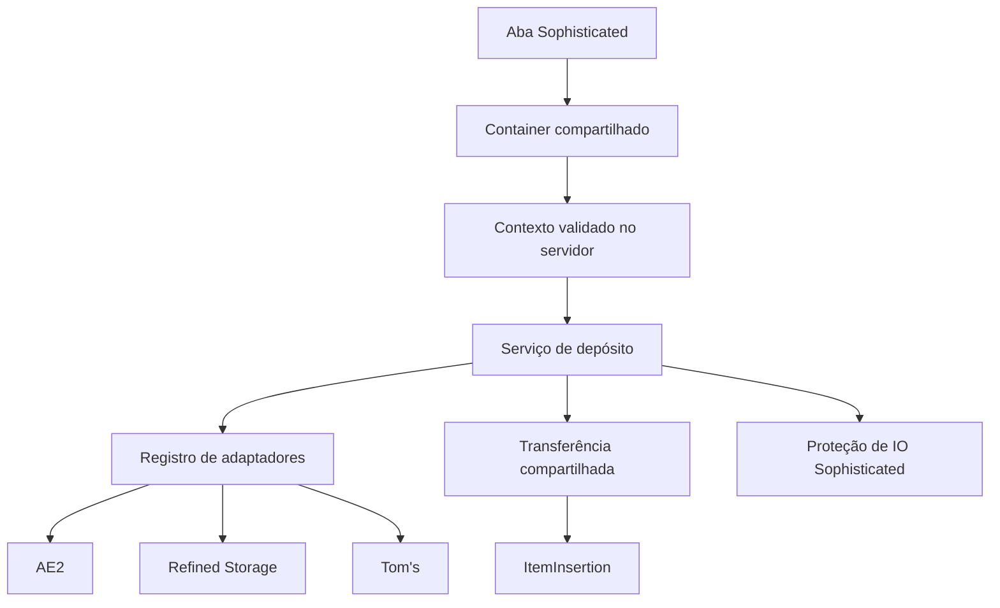

# Base de desenvolvimento dos upgrades

## Escopo

O projeto suporta Minecraft 1.21.1/NeoForge 21.1.236/Java 21 e Minecraft 1.20.1/Forge 47.4.10/Java 17. O mod se chama **Sophisticated Backpacks - Digital Storages Expansion**, com ID `sophisticated_backpacks_digital_storages_expansion` e pacote Java `com.radaeli.sophisticatedbackpacksdigitalstoragesexpansion`. Itens e receitas usam esse mesmo namespace. Os oito upgrades têm implementações específicas para as duas plataformas. Forge compila e produz um JAR reobfuscado; integração operacional completa ainda aguarda validação em jogo.

Os oito upgrades aparecem em uma aba criativa própria. A tooltip base do Sophisticated usa `item.<namespace>.<item>.tooltip`; essa chave está presente em inglês e português para cada upgrade, além das descrições das abas do Sophisticated.

A hierarquia compartilhada das tooltips segue [P02](UPGRADES.md#P02): nome nativo → descrição em `GRAY` → status em `DARK_GRAY`, destacando somente o backend vinculado em `GREEN` → instrução de desvínculo em `DARK_GRAY`, somente se houver vínculo. `LinkedStorageUpgradeItem` preserva as linhas traduzidas pelo Sophisticated e aplica essa apresentação aos oito itens em EN-US/PT-BR. `StorageText.tooltipSummary` estiliza o resumo do item; o resumo das abas permanece independente. Pump acrescenta seu aviso de fluido pendente ao status por `getLinkStatus`, antes da instrução. Endereço avançado usa `DARK_GRAY`; nenhuma rede é resolvida para montar a tooltip.

Cada função tem seu próprio item universal, configurado manualmente para um endpoint de AE2, Refined Storage ou Tom’s. Os serviços cobrem inserção, extração, pickup, magnetismo, reposição, alimentação, alquimia e bombeamento de fluidos AE2/RS. Tom’s continua sem capacidade de fluidos.

## Estrutura multiloader

O build usa `common`, `neoforge` e `forge`. `common` tem Java 17 sem dependências de Minecraft e suas fontes são incorporadas nos dois artefatos. O código com tipos Minecraft é compilado separadamente no loader correspondente; não existe binário de Minecraft compartilhado entre 1.20.1 e 1.21.1. O estado e os limites de validação do Forge estão em [MULTILOADER.md](MULTILOADER.md).

## Responsabilidades

| Parte | Responsabilidade |
| --- | --- |
| `LinkedStorageUpgradeItem` | Item Sophisticated, limite por storage, dica de vínculo e tooltip. |
| `EndpointLinkHandler` | Interação de vínculo para qualquer item que estenda a base; mantém o vínculo anterior quando o novo destino falha. |
| `LinkedStorageUpgradeWrapper` | Leitura, escrita, remoção e salvamento do vínculo pelo ciclo de vida nativo do Sophisticated. Expõe o filtro transitório de proteção de IO. |
| `LinkedStorageUpgradeContainer` | Validação dos pedidos no servidor, desvínculo, verificação de habilitação e limite de uma operação por tick do container. |
| `UpgradeOperationContext` | Origem e inventário obtidos do menu atual, após validar container, aba, validade do menu e wrapper instalado. |
| `LinkedStorageUpgradeTab` | Controles de vínculo e descrição da rede, atualizada quando o wrapper sincroniza. |
| `StorageAdapter` | Identificação e resolução de um backend opcional. |
| `StorageAdapterRegistry` | Registro dos adaptadores instalados e checagens comuns de dimensão, chunk e proteção. |
| `StorageConnection` | Resultado explícito da tentativa de acesso; diferencia vínculo ausente, mod ausente, dimensão indisponível, chunk descarregado, endpoint removido e acesso recusado. |
| `StorageTarget` | Endpoint resolvido para uma operação, com conectividade nativa, consulta de itens e inserção. |
| `StorageOperation` / `StoredItemAmount` | Autorização independente de inserção/extração e identidades com contagens `long`. |
| `FluidStorageTarget` / adaptadores | Contrato opcional de fluidos, consulta/simulação/extração/inserção em mB para AE2 e RS. |
| `ItemInsertion` | Destino de inserção associado ao jogador da operação, independente de menus e de classes dos backends. |
| `ItemTransferService` | Transferência com filtro, simulação limitada à origem, inserção real, recuperação de sobra e contagem do resultado. |
| `StorageTransferGuard` / `TransferInputFilter` | Bloqueio temporário de entrada externa na origem através de `IIOFilterUpgrade`, evitando que a rede deposite de volta na mesma mochila. |
| `DepositService` | Orquestração específica do depósito, reutilizando `DepositFilterLogic` e os serviços comuns. |
| `RestockService` / `UpgradeItemSources` | Extração de rede e mochila, com retorno de sobras; a segunda baseia-se em identidades e quantidades consultadas a cada operação. |
| Serviços Pickup/Magnet/Refill/Feeding/Alchemy | Roteamento por prioridade; automações de portador revalidam wrapper instalado/habilitado. Magnet também aceita o tick colocado com jogador elegível próximo e aplica a exceção nativa `AllowMachineRemoteMovement`; Refill `ANY` completa pilhas compatíveis antes de ocupar slots vazios. Feeding e Alchemy guardam consumíveis em reservas do item. |
| `PumpService` / `PumpReservation` | Contexto do portador ou jogador próximo à mochila colocada, alvos nativos e reserva persistida de até 1.000 mB; recupera reservas pendentes mesmo com Pump desativado e não inicia novas transferências nesse estado; Tom’s pausa a função. |
| `PumpStorageRouter` / `PumpTransferService` | Prioridade por operação, complemento parcial entre rede/tanque, seleção por fluido/componentes, simulação e recuperação. |
| `StorageTransferGuard` / `FluidTransferGuard` / `GuardedFluidHandler` | Escopos aninháveis de proteção de entrada/saída; o Mixin envolve a capability externa e verifica o bloqueio em cada chamada, inclusive em referências já em cache. |

## Ciclo de vida e segurança da operação

O wrapper persiste apenas backend, dimensão e posição. A aba e o item podem ler esses dados sem resolver uma rede ou carregar classes de um backend opcional. Objetos de jogador, bloco, rede e inventário não são salvos no item.

Cada pedido usa o container efetivamente aberto em `player.containerMenu`. A validação compara a identidade do container e do wrapper instalado, e consulta `getOpenContainer()`. O campo `UpgradeContainerBase.isOpen()` não é a autoridade: ele pode estar desatualizado imediatamente após instalar um upgrade. O mesmo guard protege alterações de filtro e ações.

O cliente envia somente o nome da ação pelo protocolo do Sophisticated. Origem, jogador, endpoint persistido e inventário são obtidos no servidor. Pedidos de um container removido, de uma aba fechada ou de um menu inválido são ignorados. As operações de transferência respeitam o estado habilitado do upgrade.

`StorageTarget` é transitório. Não armazená-lo em campos de wrappers ou containers: uma rede pode perder energia, mudar de topologia ou desaparecer. Cada operação passa novamente por `StorageAdapterRegistry.connect`. As verificações comuns consultam o mundo do endpoint e não carregam chunks.

## Transferência e proteção da origem

O motor captura os itens e quantidades presentes no começo da operação. Em cada slot, trabalha com cópias e limita a oferta à quantidade inicial ainda disponível. Itens repostos ou devolvidos a slots que estavam vazios não entram em uma segunda transferência no mesmo pedido.

A simulação informa uma estimativa. A contagem transferida vem da sobra devolvida pela inserção real, não da simulação. A recuperação tenta o slot original, os outros slots da origem e, por último, o callback de recuperação. No depósito manual, esse callback usa o inventário do jogador e a recuperação nativa de itens que não cabem.

A versão auditada de `InventoryHelper.transfer` do Sophisticated Core descarta a sobra da inserção real. Por isso o motor compartilhado mantém explicitamente a recuperação, usando os inventários e filtros nativos. O comportamento pode ser conferido no JAR fixado em [libs/README.md](../libs/README.md) com `javap -c -p net.p3pp3rf1y.sophisticatedcore.util.InventoryHelper`.

Durante a transferência, abrir `StorageTransferGuard.blockExternalInsertion(storage)` em um `try` com recursos. O filtro de IO compartilhado recusa inserções pela interface pública da própria origem, inclusive na simulação. A recuperação interna continua usando `getInventoryForUpgradeProcessing()`. O guard usa o UUID de conteúdo do Sophisticated para reconhecer wrappers que representam o mesmo inventário, suporta escopos aninhados e é removido ao fechar o escopo, inclusive após exceções.

Fora da operação, o filtro transitório mantém a combinação nativa dos filtros de IO: listas de permissão continuam se combinando por OR; a presença de listas de bloqueio mantém a combinação por AND. Ele não grava atributos nem acrescenta slots de filtro. Testes exercitam essas combinações através de `FilteredItemHandler` do Sophisticated.

Adaptadores devem devolver sobras válidas do mesmo item e componentes e não alterar os argumentos recebidos. AE2 e RS normalizam contagens nativas `long` antes de convertê-las para `int`. Uma exceção de um backend após uma inserção parcial não oferece informação suficiente para rollback; não reinserir cegamente toda a oferta nesse caso.

## Integrações

## Estado implementado

| Upgrade | Implementação presente | Validação manual pendente |
| --- | --- | --- |
| Deposit | Ação pela GUI, filtros nativos, recuperação e conflito com Deposit Sophisticated. | Regressão após refatoração em AE2, RS e Tom’s. |
| Restock | Extração por identidade, filtros, capacidade e recuperação. Reutiliza `DepositFilterLogic` com modo de inventário, não o `ContentsFilterLogic` descrito inicialmente no plano. | Conteúdo filtrado, quantidades parciais e filtros GUI. |
| Pickup | Contexto de coleta original delimitado por MixinExtras e serviço de roteamento com retorno de sobra. | Coleta real, prioridades, mochilas múltiplas e conexão. |
| Magnet | Raio do Magnet avançado Sophisticated, bloqueadores nativos via accessor, delay infinito nativo, contextos carregado/colocado e atualização parcial de entidades. | Elegibilidade, coexistência com Pickup e alcance em mundo. |
| Refill | Regras por filtro/slot-alvo e seleção de bloco com extração e tentativa de recuperação; `ANY` preenche pilhas parciais compatíveis antes de usar slots vazios. | Mãos, toolbar, seleção, slot modificado e limites de inventário. |
| Feeding | Condições nativas, uma unidade por operação e reserva persistida; retorno de recipiente. | Tipos de comida, limiares, efeitos de uso e interrupções. |
| Alchemy | Definições nativas, condições, duração escalada por ticks e reserva persistida. | Lista extensível, aplicações reais, efeitos e interrupções/reinício. |
| Pump | Mãos, seis handlers adjacentes e mundo; mochila equipada/na mão/colocada; roteamento parcial, mínimo de um balde, guard de capability em cache e recuperação de reserva mesmo desativado. | Regressão em jogo com AE2/RS, proteção/vaporização e interrupções. |

Os controles de prioridade Rede primeiro / Mochila primeiro usam o mesmo botão 16×16 da aba Magnet em Pickup, Magnet, Refill, Feeding, Alchemy e Pump. Os toggles de interação do Pump usam os sprites 16×16 e os tooltips da aba Pump avançada do Sophisticated Core. Na aba Pump, a posição dos controles acompanha a altura do filtro nativo; o vínculo ocupa uma linha separada com 8 px de distância do botão de prioridade, e a aba usa o dimensionamento automático nativo (P02/P06). Seletores por slot ou condição continuam com o controle compacto próprio.

`PriorityLinkedStorageUpgradeContainer.toggleSourcePriority` atualiza imediatamente o wrapper local e envia o valor selecionado, capturado antes da construção do pacote, seguindo os setters dos controles nativos (P04/P05/P06/P11). O servidor aplica esse valor pelo guard já existente do menu. Pickup/Magnet continuam avaliando filtros por destino: em `Stored content`, mochila vazia e sem memória para o item recusa a entrada mesmo em Mochila primeiro; um item presente somente na rede segue para ela. Essa semântica foi reconfirmada pelo usuário em 2026-10-30 e não foi alterada.

A aba Feeding expõe o seletor nativo de lista permitida/bloqueada (`FilterLogicControlBase.MatchButton.ALLOW_LIST`) acima dos nove filtros. Reutiliza ícones, tooltips, persistência e pacotes do Sophisticated; controles de fome e ferimento e o rodapé acompanham a altura real da grade. `RemoteFeedingUpgradeContainer` resolve o filtro a partir do wrapper atual após sincronização, preservando o modo e os itens configurados (P05/P06/P11; [FEEDING.md](upgrades/FEEDING.md)). A aparência final e o consumo em jogo ainda exigem validação manual (P12).

Verificação de prioridade/Feeding em 2026-10-30: `gradlew.bat build` passou nos dois loaders, com 65 testes NeoForge sem falhas e 10 GameTests Forge aprovados. As novas regressões cobrem atualização local e pacote de prioridade, reconstrução do estado salvo, filtro Feeding após substituição do wrapper e Pickup/Magnet com inventário Sophisticated real em simulação/execução. Incluem `Stored content` com item na mochila e com mochila vazia; o destino remoto é controlado, sem uma rede montada em mundo. Os JARs 0.2.0 incluem os controles atualizados. Nenhuma validação visual ou gate de rede real foi concluído por esses testes.

A aba Refill reutiliza a grade nativa de itens: cada filtro ocupado mostra o acrônimo verde do destino no próprio slot, e o scroll muda o destino e sincroniza cada passo. Indicador e hit test usam a origem absoluta do `FilterLogicControl` por `FilterSlotGrid`, compartilhado sem dependência de Minecraft; `Slot.x/y` permanece relativo ao menu e não é usado como coordenada de tela. `ItemTooltipEvent` acrescenta destino e instrução ao tooltip normal, limitado à tela/aba aberta e ao filtro sob o cursor, como no Refill original. Prioridade e vínculo ficam abaixo da grade, com o rodapé calculado pela altura do controle. Regressões de geometria e compilação passaram; a correção ainda requer prova visual em jogo (P02/P06/P11/P12; [REFILL.md](upgrades/REFILL.md)).

A aba Alchemy reproduz os controles nativos do Sophisticated Core: oito filtros fantasma de poção em duas colunas, oito botões de condição em pares, três toggles de comparação, estados desabilitados e tooltips nativos. As condições e seus valores padrão vêm das definições nativas, incluindo extensões; `HURT` usa o limiar e o scroll nativos. A prioridade e o vínculo ficam abaixo das quatro linhas de configuração. Ao carregar configurações antigas, a migração mantém os primeiros oito filtros e atributos e descarta o nono, sem tocar em vínculo, prioridade ou reserva (P02/P06; [ALCHEMY.md](upgrades/ALCHEMY.md)).

### Revisão dos fluxos do Remote Pump

Segue [PUMP.md](upgrades/PUMP.md) e P03/P04/P05/P08/P09/P10/P11. O callback nativo entrega o portador para mochila equipada/na mão e `null` para mochila colocada. Pump resolve um jogador real próximo neste último caso, conforme P04, sem dono salvo, autorização offline ou jogador falso. O alcance remoto usa a posição da mochila; autenticação e proteção usam esse jogador.

O mínimo nativo de vazão é 1.000 mB (`PumpUpgradeWrapper.getMaxInOut`, confirmado no JAR fixado). A versão anterior aplicava o limite na direção errada, permitindo menos de um balde e bloqueando baldes e fontes do mundo. O addon mantém o mínimo e limita cada reserva a um balde. Ordem de interação: mãos → mundo → tanks/tubos. Cooldowns: mãos, 3 ticks; handlers/colocação, 20; coleta, `20 × max(1, distância)`; ausência de ação, 40, ou 3 após interação recente com mãos.

`PumpStorageRouter` oferece rede/tanque na ordem configurada dentro da mesma interação. Na entrada, complementa capacidade parcial; na saída, combina apenas a mesma identidade de fluido e componentes. `PumpTransferService` considera `drain(int)` e os fluidos dos tanks, procurando outro candidato quando filtro ou destino rejeitam o primeiro. Simulação não grava reserva. A execução persiste a quantidade real antes de preencher o destino; extrações combinadas persistem cada parcela antes da próxima fonte. Sobra tenta retorno à fonte externa reversível e, quando necessário, permanece no upgrade para recuperação autorizada.

Mãos usam uma cópia de uma unidade e atualizam o recipiente pelo retorno da capability; a própria mochila é excluída por referência/UUID. Coleta do mundo usa busca por largura, raio `distância² < 16`, chunks já carregados e capacidade para um balde inteiro. Colocação usa posições adjacentes exceto acima, aceita ar/fluido corrente e preserva fontes. `FluidUtil.tryPlaceFluid` opera sobre a reserva isolada, incluindo consumo por vaporização. Tanks/tubos resolvem a capability na face oposta à direção da mochila e respeitam a proteção de interação.

O guard de fluidos começa antes de resolver/consultar a rede e também protege a recuperação. O único Mixin desse fluxo envolve o retorno de `BackpackBlockEntity.getExternalFluidHandler` em `GuardedFluidHandler`: consulta, simulação e execução verificam o UUID atual em cada chamada. Assim, um storage bus que já tenha guardado a capability não reutiliza o tanque da própria mochila durante a transferência. O acesso interno ao tanque permanece disponível.

Validação da revisão: `build` com Java 21 e 51 testes passaram (21 específicos de Pump/guard), incluindo baldes NeoForge reais, seis tiers, prioridades, quantidades parciais, componentes, reservas e carregamento da classe nativa com Mixin. O JAR atualizado foi gerado em `build/libs`. O cliente que já estava aberto continua com as classes anteriores até reiniciar; os cenários de interação com redes e mundo em [PUMP.md](upgrades/PUMP.md#8-validação-e-aceitação) permanecem pendentes.

Os oito itens usam texturas locais de 16×16 baseadas nos sprites Sophisticated avançados correspondentes. Preservam as silhuetas e os pixels de borda/cantos de cada original; a paleta remota usa verde e roxo no símbolo, amarelo vivo nos cantos preenchidos, branco nos pontos verticais e azul diamante nos horizontais. Todos os modelos apontam para suas texturas próprias. A renderização final dentro do jogo ainda aguarda conferência manual.

O cliente iniciou com os três backends opcionais carregados e entrou no mundo configurado `New World`. Isso confirma inicialização, registros e aplicação dos Mixins no processo observado; não confirma uso dos upgrades ou cada operação de storage.

| Backend | Regra mantida | Particularidade |
| --- | --- | --- |
| AE2 | Access point vinculado, nó ativo, energia e alcance nativo. Inserção com a identidade do jogador. | O storage é consultado novamente ao simular e inserir. |
| RS | Controller, permissão `INSERT` e `NetworkItemPlayerValidator` nativo para a posição da origem. | O controller resolve a rede atual; rede offline não é apresentada como bloco removido. |
| Tom’s | `StorageTerminalBlockEntity.canInteractWith(player, false)`, incluindo terminal sem fio, alcance, dimensão e beacon. | A API de alcance é centrada no jogador. Para a lista de itens, usa-se `NetworkInventory` e seu tracker, evitando o cache assíncrono da GUI do terminal. A inserção pelo terminal não tem simulação pública; a estimativa oferece a quantidade e o motor recupera a sobra real. |

A posição comum da origem é o bloco da mochila colocada, a entidade quando fornecida pelo menu, ou o jogador para uma mochila carregada. O Tom’s continua usando sua validação nativa centrada no jogador; uma validação nativa de posição arbitrária precisa de investigação própria. Não alterar temporariamente a posição do jogador nem duplicar regras de beacon para contornar essa limitação.

Somente o modo de filtro `INVENTORY` consulta o conteúdo do destino. Os modos de permissão e bloqueio usam diretamente os filtros nativos sem enumerar o storage. `SnapshotItemHandler` oferece somente identidades de itens, com componentes preservados, em uma visão de leitura.

## Como adicionar um upgrade

1. Criar o item estendendo `LinkedStorageUpgradeItem`, com um `UpgradeType` próprio e limite por storage. Registrar em `ModItems`.
2. Criar o wrapper estendendo `LinkedStorageUpgradeWrapper`. Implementar as interfaces nativas necessárias à função e reutilizar a lógica de filtro apropriada do Sophisticated.
3. Para ações pela GUI, estender `LinkedStorageUpgradeContainer`, delegar os pacotes de filtro a `handleSettingsPacket` e implementar apenas as ações específicas em `handleAction`. Expor métodos como `requestDeposit()`, mantendo strings de protocolo dentro do container.
4. Criar a aba a partir de `LinkedStorageUpgradeTab`, usar controles Sophisticated e registrar o container em `UpgradeContainerRegistry` e a aba em `ClientModEvents`.
5. Incluir o item em `data/sophisticatedbackpacks/tags/item/upgrade.json`. Herdar `UpgradeItemBase` não substitui essa tag: sem ela, a GUI da mochila pode rejeitar o item antes da interação de servidor.
6. Adicionar receita e traduções. Recursos visuais próprios continuam adiados nesta fase.
7. Testar a lógica específica e executar os cenários de integração abaixo. Manter o ID e os componentes persistidos estáveis ao refatorar.

Upgrades passivos devem usar interfaces como `ITickableUpgrade` e os cooldowns do Sophisticated. Seu contexto vem do callback nativo; não fabricar um menu aberto. A conexão e a proteção contra ciclos continuam sendo serviços compartilhados.

Ao implementar extração ou fluidos, acrescentar contratos para as operações reais necessárias. Evitar métodos de funcionalidades ainda inexistentes em todos os adaptadores ou respostas que afirmem sucesso sem suporte.

## Como adicionar um backend

Implementar `StorageAdapter` e `StorageTarget` em classes isoladas. Adicionar uma única construção condicional no registro de adaptadores instalados e declarar a dependência opcional nos metadados. Usar o mesmo backend ID no registro e no vínculo. Acrescentar nome traduzido, regras de infraestrutura e testes de ausência da dependência.

Código comum e cliente não devem importar classes do novo mod. Alcance, energia, dimensão e permissão precisam ser validados pelas APIs nativas antes de devolver uma conexão acessível. Nenhum adaptador deve solicitar carregamento de chunks.

## Verificação

`gradlew.bat build` executa a suíte JUnit e gera os JARs. A configuração usa o [suporte oficial de testes do ModDevGradle](https://github.com/neoforged/ModDevGradle#unit-testing-with-junit), com Sophisticated Core e Backpacks no runtime de testes e sem os backends opcionais.

As suítes cobrem vínculo legado, dados malformados e independentes de backend; filtros nativos de permissão, bloqueio, inventário e componentes; transferências parciais, rejeição, extração parcial, recuperação e contagens extremas; proteção de reinserção na origem e composição dos filtros de IO; e inicialização do registro sem os mods de storage.

A POC anterior teve os três backends e seus alcances confirmados em jogo pelo usuário. A refatoração precisa desta regressão em jogo antes de publicação:

- [ ] Instalar o upgrade e depositar imediatamente, sem fechar a mochila; remover e reinstalar na mesma sessão.
- [ ] Confirmar que o texto muda para sem vínculo após desvincular e que um novo vínculo substitui o anterior.
- [ ] Usar mochila carregada e colocada, incluindo os filtros nativos e a preservação de componentes.
- [ ] Tom’s: primeiro depósito com filtro por conteúdo após recarregar o mundo, sem abrir antes a GUI do terminal; validar terminais nas orientações horizontal, superior e inferior.
- [ ] Em cada backend, repetir fronteiras de alcance, amplificadores, falta de energia, destino removido, chunk descarregado, capacidade parcial e permissões.
- [ ] Expor a mochila colocada à mesma rede de destino: seus itens não devem circular de volta nem gerar um relato falso de depósito.
- [ ] Combinar o upgrade com filtros nativos de entrada e outras funções de inventário; conferir que a entrada normal volta após a operação.
- [ ] Conferir instalação no slot, GUI e ações em servidor dedicado; testar cada backend isoladamente e os três juntos.

Os testes de núcleo carregam mods e APIs reais, mas não substituem as interações de cliente ou uma rede montada em mundo.

## Consolidação do Deposit e desvínculo compartilhado

As oito receitas de criação em `data/sophisticated_backpacks_digital_storages_expansion/recipe/remote_*_upgrade.json` usam `minecraft:crafting_shaped` e o padrão `EDE / DUD / R R`, conforme [P07](UPGRADES.md#P07): E = pérola do Ender, D = diamante, U = upgrade Sophisticated avançado correspondente e R = pó de redstone. Cada receita produz um upgrade remoto. Os ingredientes centrais foram conferidos nas receitas do JAR fixado do Sophisticated Backpacks.

Deposit mantém nove filtros nativos, ID e componentes da POC. O conflito com `DepositUpgradeItem` básico/avançado usa `UpgradeConflictDefinition`, inclusive a mensagem para a ordem inversa de instalação, sem Mixin. Deposit conecta com autorização de inserção; os adaptadores também recebem requisitos independentes de extração para Restock, Refill, Feeding e Alchemy.

A aba oferece Depositar e um resumo compacto da rede. Dimensão e coordenadas aparecem no tooltip do resumo; o item mostra o endereço no modo de tooltip avançada. O feedback de vínculo é curto. Não existe ação de desvínculo via GUI ou pacote legado.

`UnlinkUpgradeRecipe`, registrada por `ModRecipes`, aceita somente um slot ocupado por qualquer `LinkedStorageUpgradeItem` vinculado nas grades 2×2/3×3. Copia uma unidade e remove somente `remote_storage_link`, preservando componentes, filtros e nome. Aceita também dados de vínculo malformados para permitir sua limpeza. Itens sem vínculo e ingredientes extras não produzem resultado. `canChangeBinding` é o ponto compartilhado para bloquear receita e novo vínculo quando futuros upgrades tiverem reservas pendentes; esses upgrades deverão sobrescrevê-lo conforme P09.

Estas alterações ainda precisam de validação visual e operacional em jogo; não constituem conclusão dos gates P12.

Verificação desta consolidação: `compileJava processResources` concluídos com Java 21, sem executar testes. Permanecem dois avisos de depreciação preexistentes em `ClientModEvents`. GUI, receita, conflitos nas duas ordens e regressão nas três redes aguardam validação em jogo.

## SCC backend (NeoForge only)

The eight universal upgrade paths now include the optional SCC 1.5.3 adapter. See [SCC integration](integrations/SCC.md) for exact coverage, native permissions, virtual decompression, component limits and outstanding runtime acceptance. This is implementation status, not gameplay validation.

## Stored content — correção de 2026-10-30

P03/P05/P06/P08/P10/P11: Pickup e Magnet avaliam conteúdo separadamente por destino: a rede usa identidades presentes no backend; a mochila conserva o filtro nativo, incluindo memória. Prioridade oferece somente a sobra ao destino seguinte, que precisa aprovar seu próprio filtro. A consulta de presença em StorageTarget não exige extração nem usa simulação de extração; comparações reutilizam stackMatchesFilter e só restringem por tipo no modo ITEM. As consultas são transitórias, sem cache entre operações.

Restock inicializa INVENTORY apenas quando não há configuração salva; reconstrução não sobrescreve ALLOW/BLOCK. Containers de Pickup/Magnet consultam o wrapper atual após sincronização. Deposit continua comparando com conteúdo da rede; Restock usa o snapshot inicial da mochila. No Forge, a consulta do Deposit passa a ocorrer dentro do guard.

A ausência de transferência manual relatada em Tom’s/SCC ainda exige reprodução com rede real. Testes isolados de filtro não comprovam descoberta da topologia, sincronização da GUI ou permissões em mundo. Validar os três modos, reabertura/reinstalação/reinício, conteúdo somente em cada destino, memória, componentes, ambas as prioridades e redes cheias/offline. Gates de jogo de P12 permanecem abertos; publicação no portal continua adiada conforme o plano SCC.

Verificação desta correção: `gradlew.bat build` passou em ambos os loaders; suíte NeoForge com 61 testes e zero falhas, incluindo sete regressões novas de filtros, persistência, prioridades/sobras e snapshot manual. GameTests existentes do Forge executados pelo build. JARs 0.2.0 gerados nos diretórios de build de cada loader. Isso não valida redes reais ou GUI; o sintoma manual relatado permanece sem reprodução em mundo.
